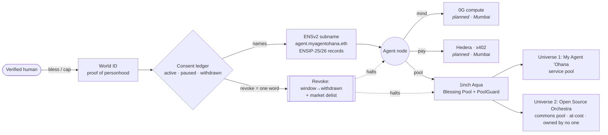

# My Agent ʻOhana — *Every Voice Is a Node*

> Hire an agent, **bless** it with verified human consent, give it a **name**, watch it work, and **stop it with one word**.

My Agent ʻOhana started at **ETHGlobal Tokyo 2026** (Sep 25–27) and comes to **ETHGlobal Mumbai** as a **Continuity** project. This README describes the project as of **5 Nov 2026, before the Mumbai hack starts**. It lists honestly what already exists and what we plan to build during Mumbai.

- Tokyo-era README (kept unchanged as history): [`docs/TOKYO-README.md`](./docs/TOKYO-README.md)
- Prior-work declaration: [`DISCLOSURE.md`](./DISCLOSURE.md) · [`docs/CONTINUITY.md`](./docs/CONTINUITY.md)
- Health check run before Mumbai: [`docs/HEALTH-PRE-MUMBAI.md`](./docs/HEALTH-PRE-MUMBAI.md)
- Pre-Mumbai snapshot tag: **`pre-mumbai-2026-11-05`**. Judges can diff from this tag to see exactly what the Mumbai weekend added.

## What it is

One open engine with **two universes** running on it:

| Universe | What it is | Money |
|---|---|---|
| **My Agent ʻOhana** | A service to the world. People hire named agents, and each agent's work is blessed by a verified human. | Paid services, run on their own pool |
| **Open Source Orchestra** | A non-profit commons for music and culture, owned by no one. | **A separate pool**, at cost, never mixed with the service pool |

Every agent is a node. It has a human blessing (**World**), a name (**ENS**), a way to get paid (**Hedera / x402**), a mind (**0G**), and a pool (**1inch Aqua**). A human can revoke consent at any time, and revoking always wins.

## Architecture

## What existed before ETHGlobal Mumbai (Continuity disclosure)

All of the following was built **before** Mumbai, at or before ETHGlobal Tokyo. It is on `main` at tag `pre-mumbai-2026-11-05`.

| Component | Where | Status at the tag (see HEALTH doc) |
|---|---|---|
| AgentLaunchRegistry (ERC-8004-aligned identity + consent window) | `contracts/src/`, Sepolia `0x62412fcA6437b914EDD87b85455682Ec73968347` | 20/20 forge tests pass · bytecode live (11,302 B) |
| ENSv2SubnameIssuer + ENSv2 deployment of `myagentohana.eth` with 10 subnames carrying ENSIP-25/26 agent records | `contracts/ens/` | `test.sh` 38/38 PASS against live Sepolia |
| World ID consent server (Cloudflare Worker + Durable Object; verifies World tokens, consent ledger, revoke) | `consent-server/` | 34/34 vitest pass · `/healthz` live (sandbox issuer) |
| 1inch Aqua Blessing Pool (wrapper + SwapVM BlessingSwap + PoolGuard) | `contracts/aqua/` | 34/34 forge tests pass |
| GiftMarket (no-custody, no-fee) | branch `lane/act1-gift-market`, Sepolia `0x4Cbc…E575` | not on `main`; not re-run for this tag |
| Hedera lane (pre-Tokyo, early work) | `integrations/hedera/`, `docs/hedera.md` | Tokyo-era. **No new Hedera/x402 code before Mumbai** |
| Static web front door | `web/`, https://myagentohana.com/ | HTTP 200 |
| Subgraph, Fetch CLI, CROPS scan apps | `subgraph/`, `integrations/fetch-cli/`, `apps/` | Tokyo-era, not re-verified |

## Planned during Mumbai (not built yet)

None of these exist at the tag. They are the weekend delta.

- [ ] **Hedera x402 desk**: an agent node charges and gets paid per request over x402.
- [ ] **0G compute "mind"**: agent inference runs on 0G, with the result tied to the agent's ENS name.
- [ ] **ENSv2 mainnet desks**: move from the Sepolia beta to mainnet-ready names for the desks.
- [ ] **Shared service-desk interface**: implement the spec in [`docs/DESK-TEMPLATE.md`](./docs/DESK-TEMPLATE.md).
- [ ] **Two-universe pool split**: keep the Open Source Orchestra commons pool separate from the service pool in Aqua.
- [ ] Revoke-everywhere: one consent revoke halts the desk, the pay rail, and the pool position.

## How to contribute

See [`CONTRIBUTING.md`](./CONTRIBUTING.md), [`CONTRIBUTORS.md`](./CONTRIBUTORS.md), and [`AI-ATTRIBUTION.md`](./AI-ATTRIBUTION.md). Good first issues are labelled `good first issue`.

## License

Code: **GPL-3.0-or-later** ([`LICENSE`](./LICENSE)). Content: **CC0** ([`LICENSE-CONTENT`](./LICENSE-CONTENT)). Vendored and third-party files keep their own licenses ([`NOTICE`](./NOTICE)).
